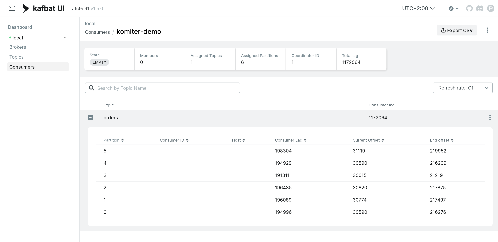
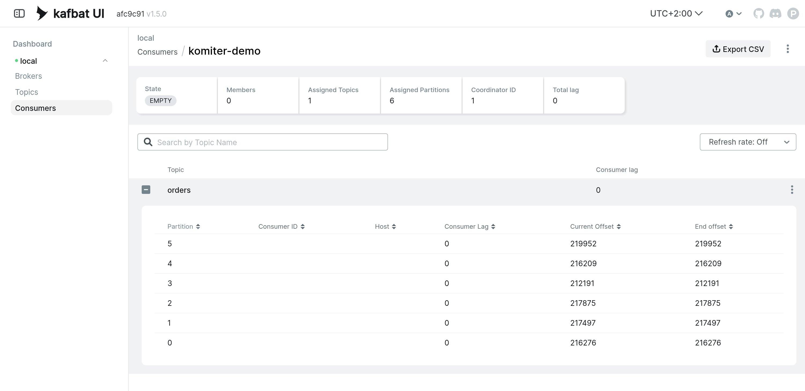
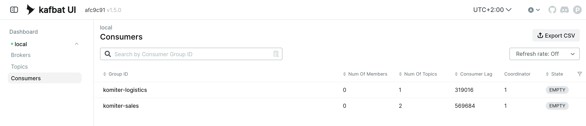
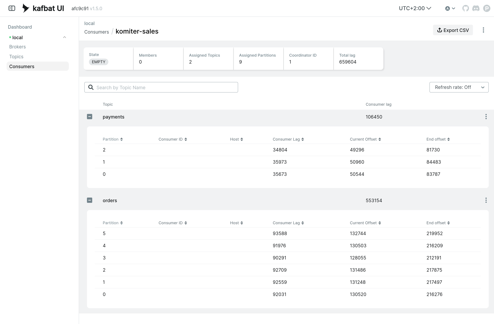
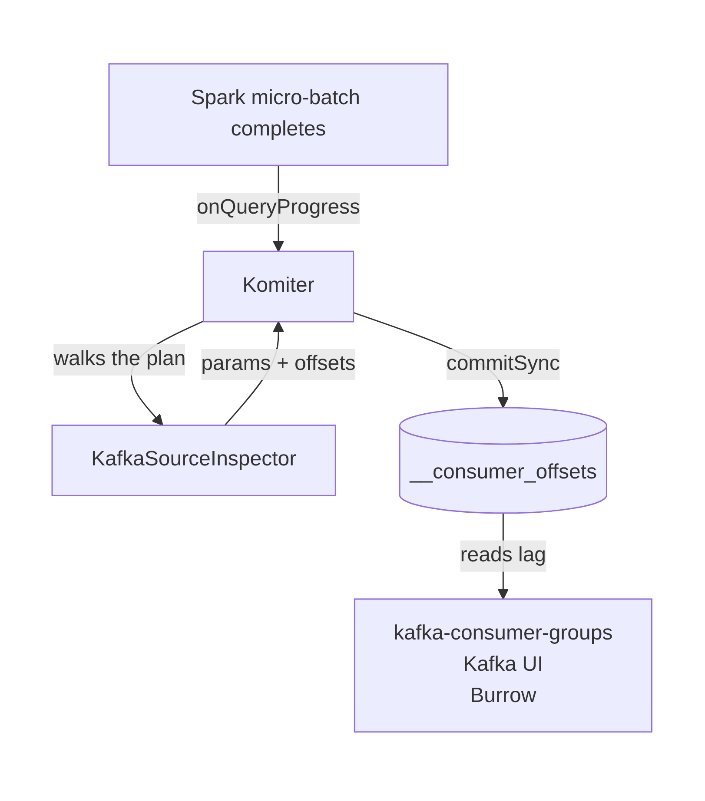

<p align="center">
  
</p>

<p align="center">
  
  
  
  
</p>

<p align="center">
  <b><a href="#quick-start">Quick start</a></b> ·
  <a href="#multiple-topics-multiple-sources">Multiple topics</a> ·
  <a href="#how-it-works">How it works</a> ·
  <a href="demo/">Run the demo</a>
</p>

---

## Your streaming job is invisible

Spark Structured Streaming keeps its Kafka offsets in its own checkpoint and never tells Kafka
where it got to. So the tools your platform team already runs — `kafka-consumer-groups`,
Kafka UI, Burrow, Grafana dashboards — have nothing to show. There is no consumer group. No
lag. No alert when the job falls behind.

The usual workarounds are to scrape Spark's own metrics into a second monitoring stack, or to
write a bespoke exporter per job. Komiter takes the other route: it makes your query look like
something every one of those tools already understands.

|  | Without Komiter | With Komiter |
|---|---|---|
| `kafka-consumer-groups --describe` | nothing to describe | full per-partition lag |
| Kafka UI / Redpanda Console | job does not appear | shows up as a consumer group |
| Lag alerting (Burrow, Cruise Control…) | needs a separate pipeline | works out of the box |
| Spark's fault tolerance | unchanged | **unchanged** |

**One listener, one option, no changes to your query logic.**

## See it



Spark never joins a consumer group, so the group reads as `EMPTY` with 0 members — Komiter
writes the offsets on its behalf. Every lag tool treats them like any other consumer's.

Once the query drains the backlog:



<details>
<summary>The same thing from the command line</summary>

```console
$ kafka-consumer-groups --bootstrap-server localhost:9092 --describe --group komiter-demo

GROUP         TOPIC   PARTITION  CURRENT-OFFSET  LOG-END-OFFSET  LAG
komiter-demo  orders  0          220241          257046          36805
komiter-demo  orders  1          221664          260848          39184
komiter-demo  orders  2          221786          258621          36835
komiter-demo  orders  3          216392          255768          39376
komiter-demo  orders  4          220246          257984          37738
komiter-demo  orders  5          223661          259733          36072
```

</details>

## Quick start

**1.** Add the dependency:

```xml
<dependency>
  <groupId>com.komiter</groupId>
  <artifactId>komiter_2.13</artifactId>
  <version>4.3.0</version>
</dependency>
```

**2.** Register the listener, in your Spark config:

```
spark.sql.streaming.streamingQueryListeners=com.komiter.Komiter
```

**3.** Name the consumer group on the source you want committed:

```scala
spark.readStream
  .format("kafka")
  .option("kafka.bootstrap.servers", "localhost:9092")
  .option("subscribe", "orders")
  .option("kafka.consumer.commit.groupid", "my-group")   // <- the only new line
  .load()
```

That is the whole integration. Sources without that option are left alone, so you can adopt it
one query at a time.

> **It does not replace Spark's checkpoint.** Spark keeps full control of its own offsets —
> that is what makes it fault-tolerant. Komiter writes a *copy* of the progress into Kafka for
> the ecosystem to read. A failed commit never affects the query.

Rather try before you install? [`demo/`](demo/) brings up Kafka and Kafka UI with one
`docker-compose up` and runs a real query through it.

## Multiple topics, multiple sources

One query can read several Kafka sources, and any one of them can subscribe to several topics.
Each source commits to its own group:

```scala
val sales     = read("subscribePattern", "orders|payments", groupId = "komiter-sales")
val logistics = read("subscribe",        "shipments",       groupId = "komiter-logistics")
sales.union(logistics).writeStream...
```



`komiter-sales` spans two topics and nine partitions, all from a single source:



This is the case the original project could not handle, and it is where most of the work went.
A source reading several topics reports the accumulated end offsets of all of them, and Spark
only emits scans for the sources that had new data in the batch — so attributing offsets by the
position of a leaf in the plan silently breaks as soon as one source idles.

## How it works

<p align="center">
  
</p>

On every `onQueryProgress`, Komiter walks the executed plan for Kafka source leaves, recovers
their Kafka parameters by reflection, matches each leaf to its entry in
`StreamingQueryProgress.sources` **by stream identity**, and commits that source's end offsets.

`__consumer_offsets` is Kafka's own internal topic — the broker stores every consumer group's
committed offsets there, and Kafka prefixes its internal topics with a double underscore so
they stand apart from yours. Komiter does not create anything: it writes into the same place a
regular consumer would, which is exactly why existing tooling picks it up with no configuration.

`KafkaConsumer` instances are cached and reused across micro-batches, keyed by the full Kafka
param set, so the bootstrap cost is paid once instead of on every commit.

**Micro-batch queries only.** Spark reports no progress for continuous processing
(`Trigger.Continuous`), so there is nothing for Komiter to commit there; such a query runs
exactly as it would without it. Joins and aggregations are fine, including stream-static joins:
a batch read of Kafka on the static side has no progress of its own and is never committed.

## Compatibility

**The artifact version is the Spark version.** `komiter_2.13:4.2.0` is the build for Spark
4.2.0 — there is no separate connector version to map. Pick the one matching your cluster.

This build targets:

| Spark | Scala | Java | Kafka clients |
|-------|-------|------|---------------|
| 4.3.0 | 2.13 | 17 | 3.9.2 |

Every Spark release Apache still maintains is supported — **3.5.0 onwards**, twenty-four of them,
each its own tag. The floor is not arbitrary: Spark 3.5 is the last 3.x line under
maintenance, as an extended LTS running to November 2027, and every earlier line is end of
life. The Spark 3.x line is cross-built for Scala 2.12 and 2.13; Spark 4.x is 2.13 only,
because that is all Spark itself publishes.

Scala, the Kafka client and the Java target are not chosen by this project. They are copied
from Apache Spark's own pom for each release, so the connector cannot pull a Kafka client or
a Scala runtime that differs from the one your Spark was built against. Spark and Kafka are
declared `provided`: the jar carries none of them, and cannot collide with what the cluster
already has on its classpath.

<details>
<summary>All supported versions</summary>

| Spark | Scala | Kafka clients | Java |
|-------|-------|---------------|------|
| 3.5.0 – 3.5.9 | 2.12, 2.13 | 3.4.1 | 8 |
| 4.0.0 | 2.13 | 3.9.0 | 17 |
| 4.0.1 – 4.0.5 | 2.13 | 3.9.1 | 17 |
| 4.1.0 – 4.1.4 | 2.13 | 3.9.1 | 17 |
| 4.2.0 – 4.3.0 | 2.13 | 3.9.2 | 17 |

Each one is a tag, `v<spark-version>`, and every one of the thirty-four artifacts is compiled
before release. See [`tools/`](tools/) for how that is produced and checked.

</details>

## Caveats

- **The option must be prefixed with `kafka.`** so Spark forwards it to the consumer params,
  which is where Komiter can see it. Kafka logs an "unknown configuration" warning for it at
  startup; filter it in your log4j config if it bothers you.
- **Pick group IDs deliberately.** Spark assigns each query a unique internal group ID so
  queries do not collide. You are overriding that for commit purposes only, so two queries
  sharing one group ID will overwrite each other's offsets.
- **Reflection over Spark internals.** Komiter reads private fields of the Kafka connector, so
  a Spark upgrade can break it. That is the price of doing this from outside Spark — see
  [SPARK-27549](https://issues.apache.org/jira/browse/SPARK-27549), where adding it to Spark
  itself was proposed and declined.

## Credits

Komiter is a fork of
[HeartSaVioR/spark-sql-kafka-offset-committer](https://github.com/HeartSaVioR/spark-sql-kafka-offset-committer)
by Jungtaek Lim, unmaintained since 2021. The original design — including the reflection
approach borrowed from [Spark Atlas Connector](https://github.com/hortonworks-spark/spark-atlas-connector)
— is his.

This fork adds the port to Spark 4.x / Scala 2.13, the migration from SBT to Maven, offset
commits for multi-topic and multi-source queries, and consumer reuse across micro-batches.

## License

Apache License 2.0 — see [LICENSE](LICENSE) and [NOTICE](NOTICE).
